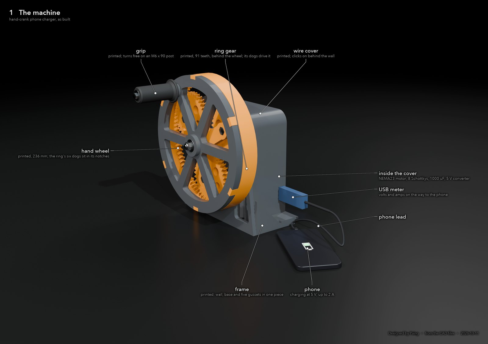
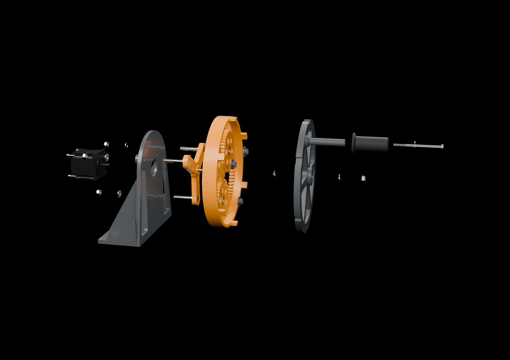
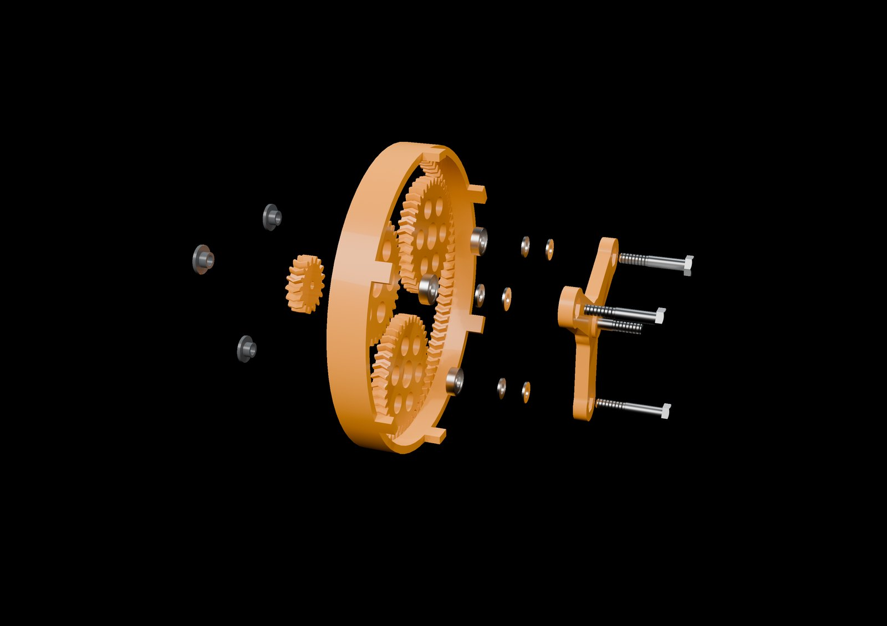
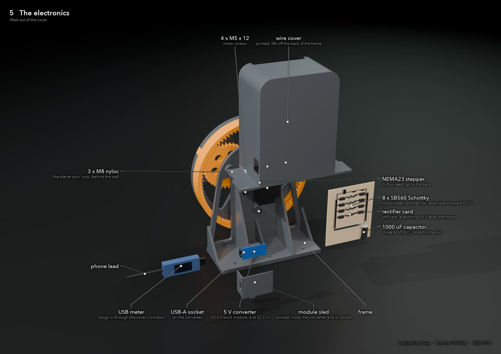
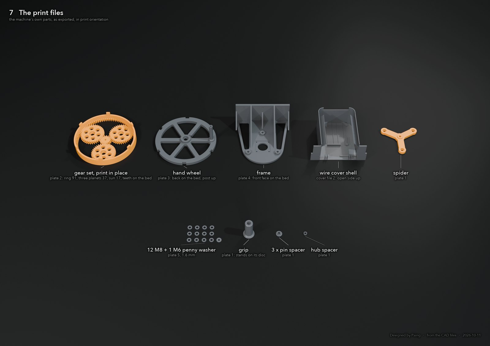

# Crank charger

A hand-crank phone charger: a printed planetary drive, a stepper motor run backwards as an alternator, two Schottky bridges, a capacitor and a buck converter to USB 5 V. Every plastic part is printed; the gearbox is printed in one job, already meshed.

MIT licence · [Design document (PDF)](docs/design_document.pdf) · [Showcase video, 16:9](video/crank_showcase_16x9_filmcraft.mp4) · [9:16](video/crank_showcase_9x16_filmcraft.mp4)

  

Rendered from the part files. The machine on the bench is built from these same files.

## Status

**Built, not yet measured.**

| | |
|---|---|
| Mechanism | Every plate printed (PLA and PETG on a Bambu P1S) and assembled on the bench, October 2026 |
| Electronics | Eight SB560 Schottkys soldered lead to lead as a ladder on a card, a 1000 uF 50 V bus capacitor, a 6 to 32 V buck module with a USB-A socket, a 4 to 30 V USB meter in the lead |
| First sign of life | 12 October 2026: an iPhone 17 Pro showed the charging icon while the wheel was turned. No meter reading, cadence or film yet, so this is an observation, not a result |
| Prediction | 10 W into the phone for 17.5 W at the hand at 90 rpm, from `design.py`, written down before the first test |
| Exit test | 60 s of continuous cranking on film, the phone charging, the USB meter in shot, the measured watts next to the predicted number. Due 25 October 2026 |

Nothing in this repository claims a measured number. Iron loss is not modelled and the mesh efficiency is a guess, so the real figure will be lower than the prediction.

## How it works

**The generator has a torque ceiling.** `sim/alternator_sweep.py` runs the stepper as an alternator through SPICE: two phases, two Schottky bridges, a DC bus. Winding inductance caps the current whatever the speed. At 400 Hz the coil's reactance is 6.3 ohm against 0.9 ohm of resistance, so the current it can pass stays near 2.5 A and the torque it absorbs is pinned at about 0.335 N m for the NEMA23. Extra watts come only from extra rpm.

**So the drive multiplies speed, not torque.** The gear train speeds the shaft up 5.35 times. The generator's fixed torque comes back to the hand multiplied by that ratio, which is what makes the crank feel heavy: about 1.85 N m, 19 N on the grip at 100 mm.

**A 5 V buck needs about 7 V in.** A NEMA17 behind one 5:1 stage peaks at 7.8 V and, after two diode drops, leaves the converter nothing. That is why the motor is a NEMA23 and the ratio is what it is.

The chain from 90 rpm at the hand to 10 W at the phone is worked through line by line in the [design document](docs/design_document.pdf): ratio, rpm, back-EMF constant 0.318 V per rad/s from the motor's own label, 16 V peak per coil at 482 rpm, reactance, current limit, diode and converter losses, 57 percent hand to phone.

**The honest payoff.** A phone battery holds about 15 Wh. At 10 W into the phone, one percent takes about a minute of cranking at roughly 17 W of effort. This is a demonstrator of a drivetrain and an energy chain, not a practical charger.

## The mechanism

  

One herringbone planetary stage, module 2.4, run as a star drive: the carrier is fixed, the ring is what you crank, the sun is on the motor shaft.

| | teeth | role |
|---|---|---|
| ring | 91 | the 236 mm wheel you turn, driven through six dogs |
| planets | 37, three of them | idlers on 608 bearings, on M8 pins fixed to the frame |
| sun | 17 | on the motor's D-cut shaft, turning 91 / 17 = 5.35 times faster than the hand |

The three pins run from the wall, through the planets, into a fixed spider in front of the gears. The spider carries the axle for a spoked wheel with the grip on it, and that wheel drives the ring through six dogs. The hand's side load goes wheel, axle, spider, pins, wall; the teeth carry torque only. The ring floats and is centred by the planets, which is what shares the load between them.

  

Herringbone teeth cannot be slid into each other, so ring, planets and sun are printed in place as one job with the flanks 0.28 mm apart. A two-gear coupon printed the same way is the first print: if the coupon gears come apart and spin, the gearset will too.

Everything is generated by `cad/planetary.py` from the tooth counts in `design.transmission()`. The script runs about fifty geometric checks (centre distances, clearances, overhangs, bolt engagement, 3D collision between parts) and refuses to export an STL if one fails.

## The electronics

  

Each stepper phase feeds its own bridge of four SB560 Schottky diodes. The two bridges share a DC bus with a 1000 uF 50 V capacitor (the bus reaches about 24 V unloaded, so 25 V parts are not enough). A ready-made buck module brings it to 5 V on a USB-A socket, and a plug-in USB meter in the lead shows volts, amps and watts. No surface-mount parts and no bare ICs anywhere: the diodes are soldered lead to lead as a ladder taped to a card, with the rule "all eight bands point at plus". The build steps with pictures are in [`electronics/ELECTRONICS.md`](electronics/ELECTRONICS.md).

A printed cover slides over the motor from behind and holds the card, the converter and the meter: [`cover/COVER.md`](cover/COVER.md).

## Printing and building it

  

- [`PRINT.md`](PRINT.md): print order, slicer settings that survived a first gearset that came out as spaghetti, hardware list, assembly sequence.
- [`assembly/assembly_steps.pdf`](assembly/assembly_steps.pdf): the build as nine rendered pictures.
- `cad/stl/`: every part; `cad/stl/batches/` packs them onto full P1S plates, one STL per print job.
- `cad/stl/spares/`: the repairs made along the way (a clip-together two-half ring, a bayonet wheel, a click-on frame, a wheel keeper band). Each has its own notes file next to it. These were drawn when a part broke on the bench and are not all tested.

## Files

| | |
|---|---|
| `design.py` | the scorer and the prediction lock. `transmission()` holds the design decision; `python3 design.py lock` writes the predicted watts to `prediction.json` before the first test |
| `sim/alternator_sweep.py` | SPICE sweep of the stepper as an alternator (ngspice) |
| `cad/gears.py` | involute spur, herringbone and ring-gear generator in CadQuery; rolls a pair through one pitch and measures every gap |
| `cad/planetary.py` | frame, print-in-place gearset, spider, wheel, grip, spacers, washers, and the checks on them |
| `cad/wire_cover.py` | the electronics cover |
| `cad/exploded_figures.py`, `cad/exploded_labels.py` | the labelled exploded pictures (Blender headless, then PIL) |
| `cad/showcase_video.py` | the showcase renders (Blender) |
| `video/filmcraft_build.py` | assembles the showcase cut in FilmCraft: picture, narration, titles, fades, export |
| `electronics/checks.py`, `electronics/verify.py` | expected bench readings and the same numbers with the soft constants banded (ngspice; model values, nothing measured) |
| `cad/old_spur_stage/` | the single-stage layout this replaced. Complete, never printed |

Python 3.12 with CadQuery 2.8, shapely and trimesh; Blender 5.2 for the renders; ngspice for the sweep.

## Tools and credit

The design decisions are mine: the motor, the single big planetary stage, the tooth counts, the module, the print-in-place gearset, and every change made when a part broke. The CAD generators, the checks, the render and video scripts were written with Claude (Anthropic) and reviewed by running them against the printed parts. The renders are of the CAD; the photographs and the measured numbers will be added when the exit test is filmed.

Designed by Paing Hein Htet, London, 2026. [paingheinhtet.com](https://paingheinhtet.com)
