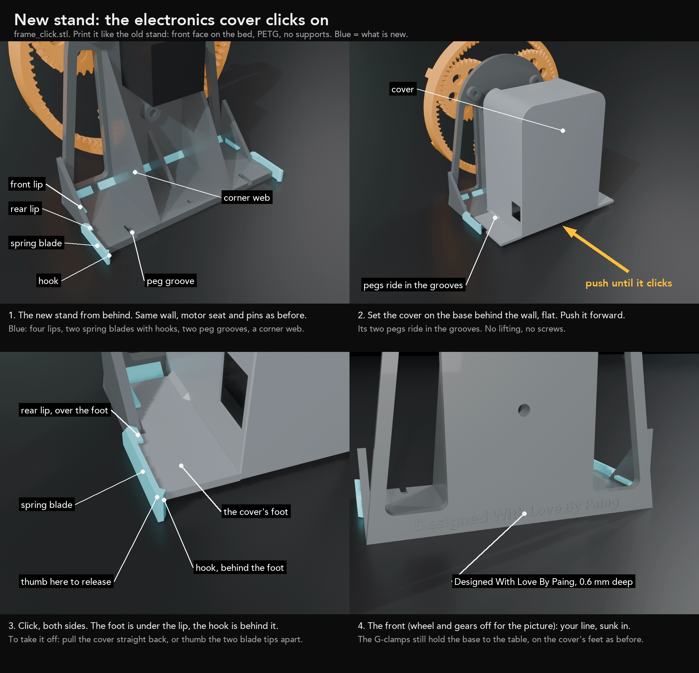

# New stand: the electronics cover clicks on

**Print:** `frame_click.stl`, one piece, 216 x 225 mm on the plate, 105 mm tall.
PETG (the two spring blades need it; not PLA). 0.2 mm layers, 4 walls, 25 percent infill, supports OFF.
Load it as it comes: front face on the bed, like the old stand. Do not rotate it over.

**What is the same:** the wall, the motor seat and its four screw holes, the three pin bosses, the five
gussets, the three base holes. Motor, pins, gears and wheel go on exactly as before.

**What is new (blue in the pictures):**

| | what | why |
|---|---|---|
| 2 peg grooves | slots in the base's top, open at the back | the cover slides on flat: no more lifting it 3 mm |
| 4 lips | two on the outer gussets, two at the back corners | the cover's feet slide under them: it cannot lift |
| 2 spring blades with hooks | along the base's sides, at the back | the hooks spring in behind the cover's feet: the click |
| corner web | where the base meets the wall | more plastic at the joint |
| your line | sunk 0.6 mm into the front, under the wheel | "Designed With Love By Paing" |

**Putting the cover on**

1. Wire everything first, as the cover guide says. Cover lying behind the machine.
2. Set the cover on the base behind the wall, flat. Its two pegs sit in the two grooves.
3. Push it forward until both sides click (about 1 kg of push).

**Taking it off:** pull it straight back, firmly (about 2 kg). Or thumb the two blade tips apart and slide it back.

**The G-clamps** still clamp the base to the table, on the cover's feet, as before. They no longer hold the cover.

**It fits the cover you already have** (`2_cover_shell.stl`): nothing on the cover changes.

## What I do not know

- **Where the old stand broke.** Send a photo of the break. If it is a weak spot I thicken it before you print this.
- This is drawn and checked (22 checks), not printed. The hooks are the part most likely to want a tweak:
  too stiff or too loose, tell me and I change the blade's thickness (now 2.4 mm).
- The hooks are a firm catch, not a dead lock: a hard pull takes the cover off. That is on purpose
  (a dead lock cannot be printed without supports here).

Files: `cad/frame_click.py` (the part and its checks), `cad/frame_click_pictures.py` (the pictures).
