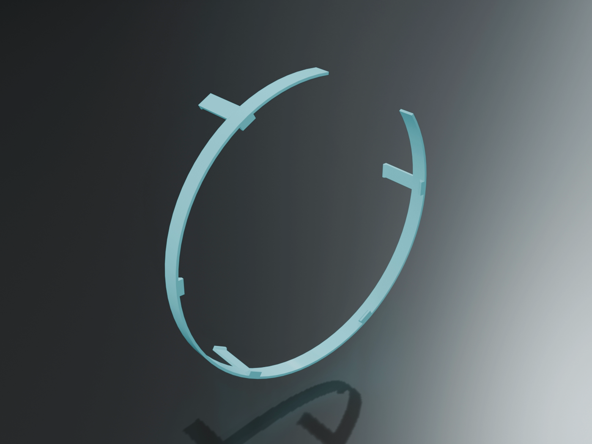
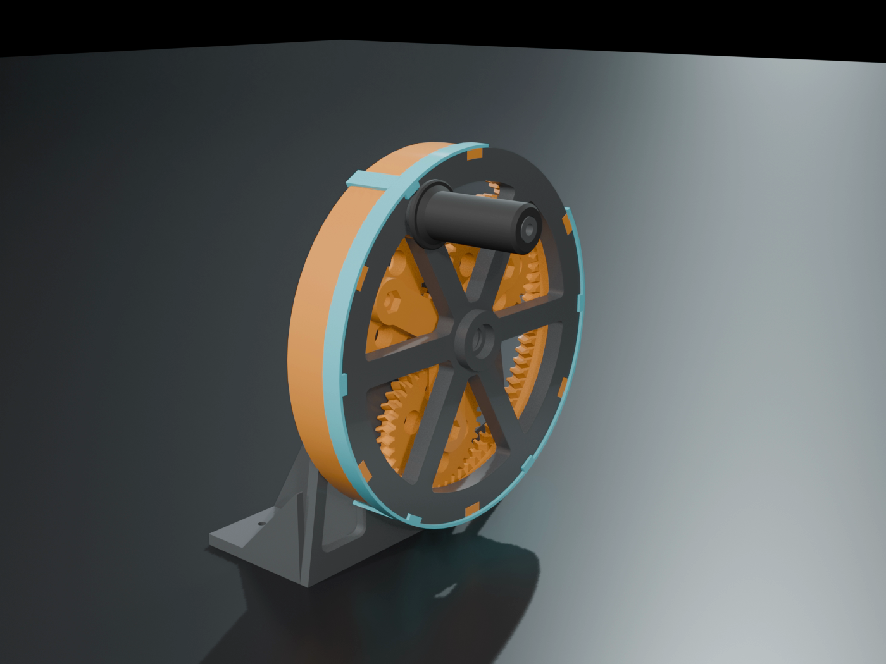
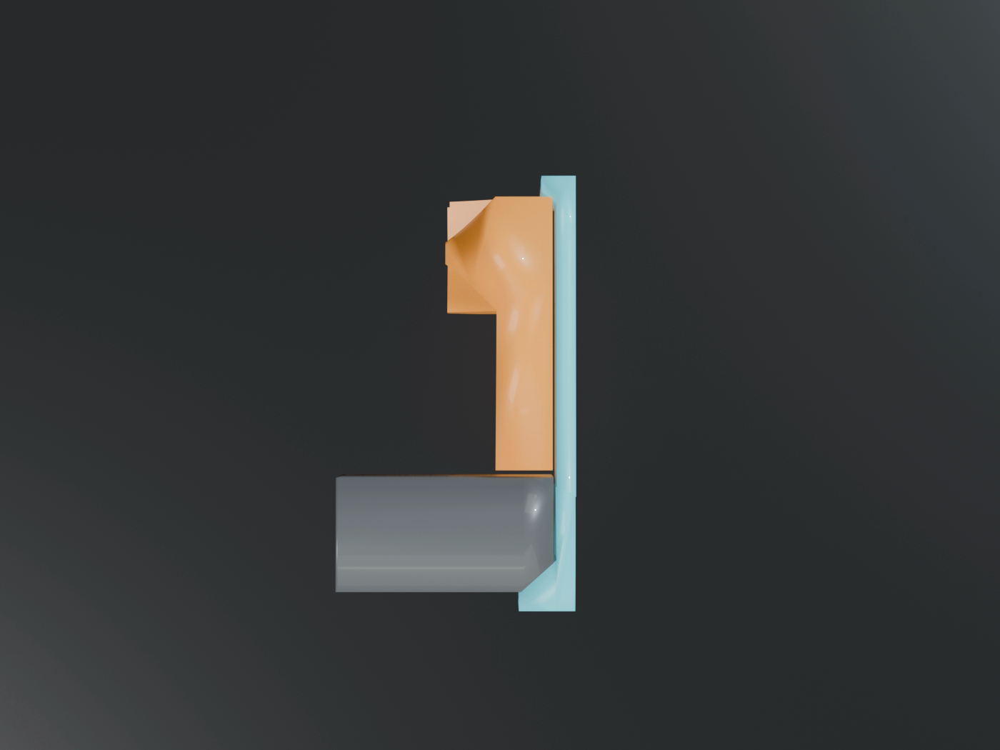
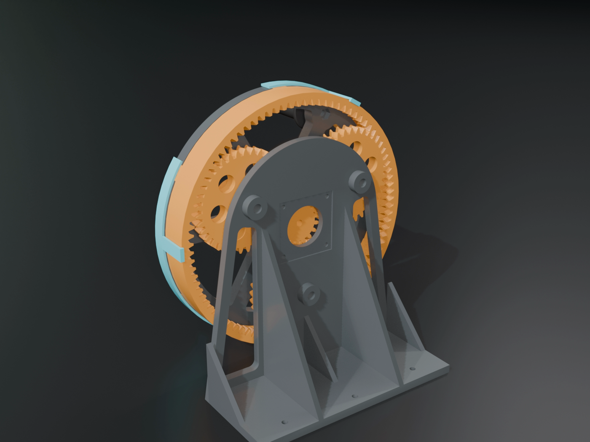

# Wheel keeper band: the hand wheel clicks onto the ring gear

**Print:** `wheel_keeper_band.stl`, one piece, 241 x 241 x 46 mm, about 26 g, roughly 40 minutes.
PETG (same roll as the gears if you can). 0.2 mm layers, 3 walls, 20 percent infill, supports OFF, no brim.
Load it as it comes: the six little tabs (lips) are on the bed, the three arms stand up. Do not rotate it.

**Why the wheel was falling off.** The wheel is only *driven* by the six dogs. What *holds* it on is the
M8 washer and nyloc on the end of the axle bolt (assembly step 7). Without that nut, nothing stops the wheel
sliding forward off the dogs. This band holds the wheel to the ring gear itself, nut or no nut.

**What it is.** A 2 mm band, open for 50 degrees, that sits round the OUTSIDE of the wheel rim. Six lips
reach 4 mm in over the wheel's front face, between the notches. Three arms run back along the outside of the
ring's skirt and end in a barb that tucks under the ring's back edge, in the 3 mm gap in front of the wall.
Lips hold the band to the wheel, barbs hold it to the ring: the wheel cannot leave the ring.

**How it clicks on (ring on the wall, wheel pushed onto the dogs first):**
1. Hold the band with the three arms pointing at the wall and the opening at the top left, where the picture shows it.
2. Spread it at the opening with both thumbs (it opens easily: it is a 2 mm wall, 24 cm across).
3. Slip it over the wheel rim. The arms go down past the ring's skirt; keep each arm between two dogs.
4. Let go. Press each arm in: the barb drops into the gap behind the ring. Press each lip down onto the wheel's face.

**To take it off:** spread it at the opening and lift it away. Nothing to unscrew.

**The cut shows the hold.** Top: a lip sitting 0.2 mm above the wheel's front face. Bottom: the barb,
1.6 mm under the ring's back edge, 1 mm clear of the wall. The band itself has 0.3 mm of air to the rim.

**It never touches** the teeth, the handle, the wall or (on the clip ring) the seven lugs and their clips:
the arms sit at 0, 120 and 240 degrees, the lugs are 18 mm away at the nearest.

**Still fit the nut when it arrives.** The band keeps the wheel on; the nut and washer also set the wheel's
endfloat on the bearings. Both together is the design.

Checks: `cad/wheel_keeper.py` (24 ok, 0 failed, 2 notes). Pictures: `cad/wheel_keeper_pictures.py`.
