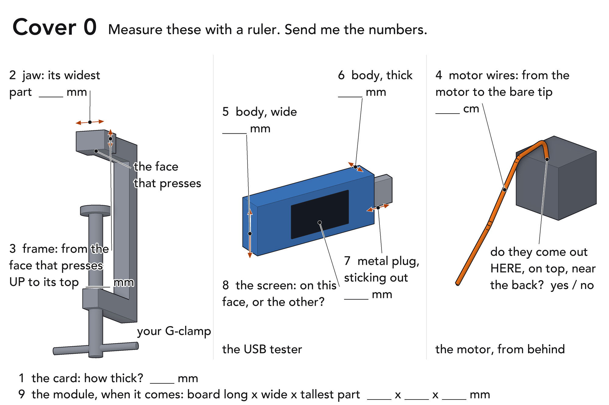
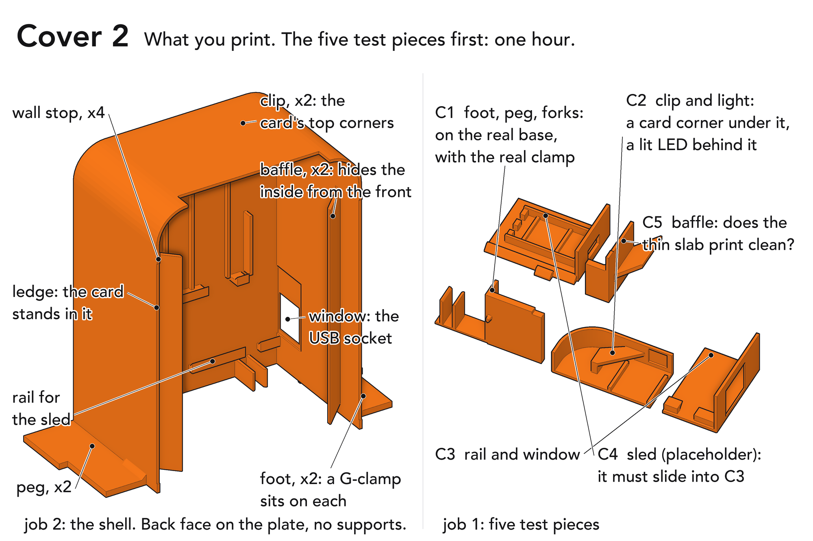
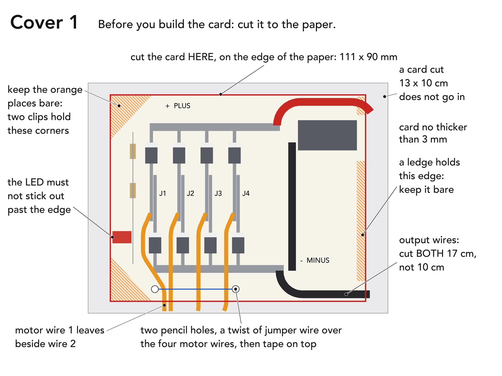
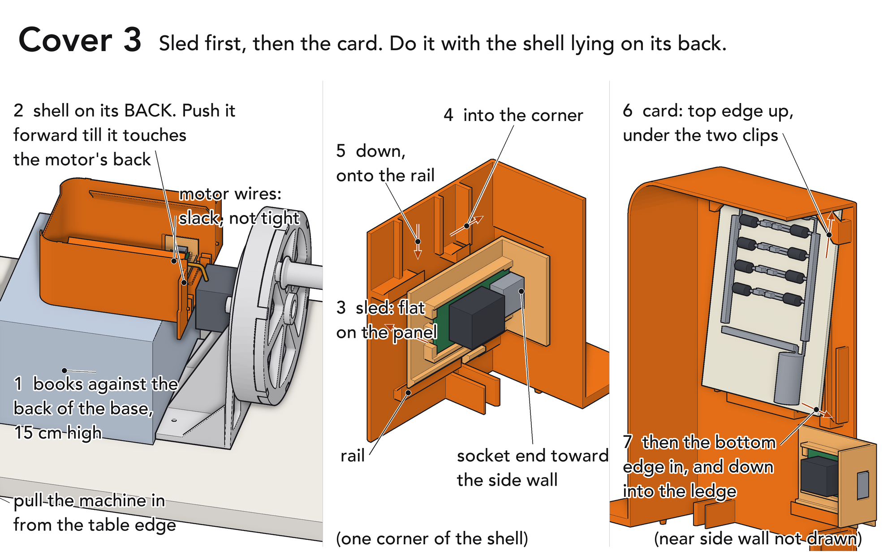
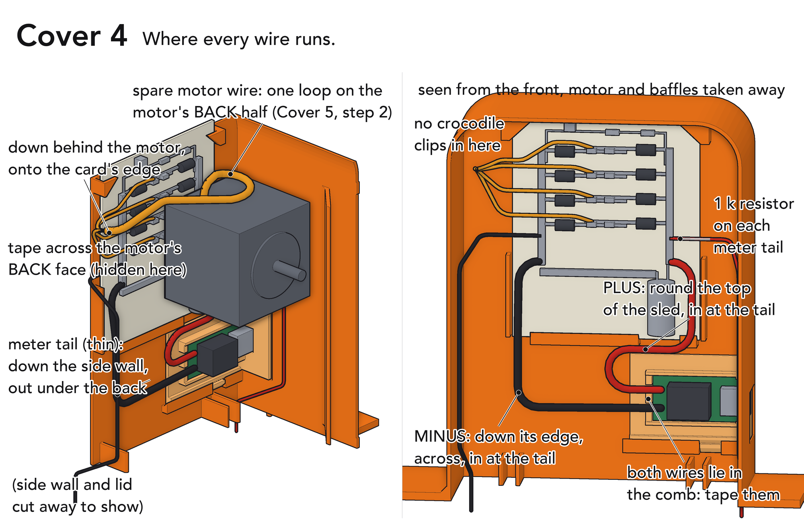
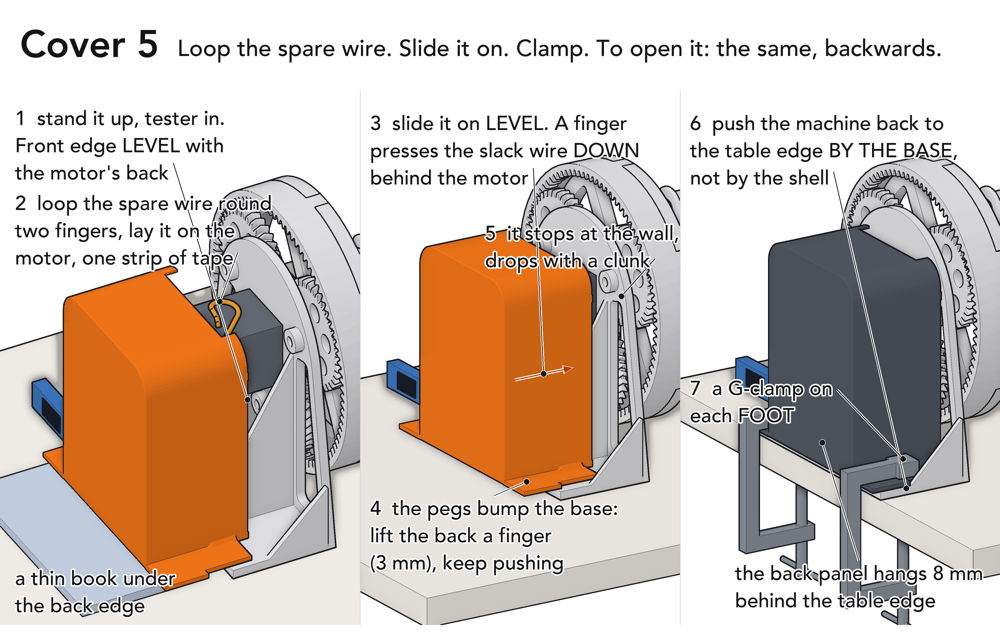
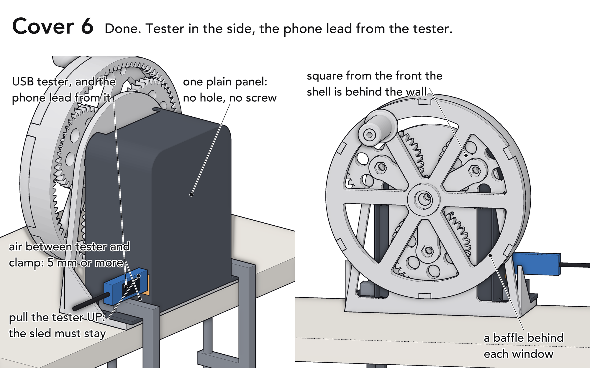

# Wire cover: what to do now

> 1. **Print job 1 today:** `cad/stl/cover/1_cover_coupons.stl`. One hour.
> 2. **Measure things 1 to 8 in the picture below. Send me the numbers.**
> 3. **Do NOT print the shell until I say.**
> 4. Cut the card on the paper's edge: 111 x 90 mm.
> 5. Cut both output wires 17 cm.
> 6. The film does not need the cover.

---

One printed shell behind the wall hides the card, the module and every wire.
No screws, nuts or glue: the same two G-clamps hold it.

**Status: CAD only. Nothing printed, nothing fitted.** Not "working" until the
four checks at the bottom pass on the real machine.

**Film rule.** Sled not seated or checks not passed by the evening of 24 Oct:
film with the shell off and the card on the table.

## 1. Print, in this order

| job | file (`cad/stl/cover/`) | when | filament | time (guess, not sliced) |
|---|---|---|---|---|
| 1 | `1_cover_coupons.stl` | now | the SAME roll the shell will use | 1 hour |
| 2 | `2_cover_shell.stl` | when I say: coupons passed, numbers sent, module and tester in your hand | PETG if you have 240 g, else plain PLA | 7 to 8 hours |
| 3 | the sled, redrawn from your real module. NOT the file in the folder | when the module arrives | PETG | 20 minutes |

- Slicer: the table in `PRINT.md`. 0.2 mm layers, 4 walls, supports OFF, no brim.
- Slot: the one with PETG (or plain PLA), not the "Support for PLA" roll the
  AMS showed in slot 2 on 30 Sep.
- Do not turn or mirror anything. Ignore the two `_..._NOT_FOR_PRINTING` folders.
- Job 2 waits: the shell has one window, on ONE side (the tester's screen
  decides) at ONE height (your clamp decides). 7 hours still fits between
  22 and 25 Oct.

## 2. Measure these first

| # | what | number | it must be |
|---|---|---|---|
| 1 | card thickness | ____ mm | 3 or less |
| 2 | clamp: widest part of the top jaw | ____ mm | 24 or less: anywhere on the foot. 24 to 30: behind the short gusset. More: tell me |
| 3 | clamp: D, from the face that presses UP to the top of the frame | ____ mm | rule below. Guessed 14, never measured |
| 4 | motor wires, motor to bare tip | ____ cm | 30: as drawn. 50: tell me, or cut to 30 |
| 5 | tester: body width, W | ____ mm | rule below. Guessed 24 |
| 6 | tester: body thickness | ____ mm | guessed 12 |
| 7 | tester: metal plug sticking out | ____ mm | guessed 12 |
| 8 | tester: which face has the screen | ____ | decides the window's side |
| 9 | module, when it comes: board long x wide x tallest part | ____ x ____ x ____ mm | up to 47 x 36 x 12, or 47 x 28 x 15 |

Also yes / no: card cut on the paper's edge (it must be)? Motor wires leave
the motor on top, near the back? No tester yet: send 1 to 4 now.

**Rule for 3 and 5: 37.4 - W/2 - D must be 5 mm or more.** The tester sits
right above a clamp's arm, and the window fixes its height. Less than 5: I
redraw the SLED as a shelf (tester flat, screen up, board up to 25 mm wide):
same shell, 20 minutes. Board wider than 25 mm as well: I move the window in
the file first. Shell printed first and wrong: a second 7 hour shell.

You send numbers. I change the file. You edit nothing.

## 3. Before you build the card

- `ELECTRONICS.md` step 0 says 13 x 10 cm: that card does NOT go in.
  **Cut on the paper's edge: 111 x 90 mm.** Already built bigger: trim it
  to the paper's edge with scissors.
- Both output wires 17 cm, not 10.
- Tie the four motor wires down: two pencil holes, a twist of jumper wire
  over them, tape on top. A finger of slack at every solder joint.

## 4. Bench tests first, cover OFF

E4 to E9 with the card flat on the table, as `ELECTRONICS.md` says. The cover
goes on last: inside it nothing can be reached.

Film (E10): NO crocodile clips on the rails (no room; a clip can touch the
motor). Either read the tester and leave the meter out, or fit two thin meter
tails (Cover 4): a 1 k resistor from the kit on each rail, a thin wire from
each, down the side wall, out under the back. METER only, never the bench supply.

## 5. Sled, then card: shell on the books

- Books 15 cm high (13 to 16 is fine; higher and the shell rides over the motor) against the BACK of the base. Shell
  pushed forward till it touches the motor's back: 30 cm wires then have 8 cm
  to spare. Further back, or on the bare table, they are too short.
- Card loose under the clips: two folds of masking tape on its back.

## 6. Where the wires run

- First, two layers of masking tape across the motor's back face.
- The spare motor wire is looped in Cover 5, step 2. Not before, not after.

## 7. Loop the spare wire, slide it on, clamp

- Keep this order: on the books the wires have nothing to spare for a loop;
  once home no hand reaches the motor.
- 30 cm wires give about ONE loop. About 8 cm stays slack once home: press it
  down behind the motor as you push.
- Tester in BEFORE the shell goes on: its plug locks the sled down.
- To open: clamps off, pull the machine in from the edge, lift the back 3 mm,
  slide the shell back, lay it on the books.
- Off the machine the shell lies on its back. Never stand it on its pegs.

## 8. Done

Re-snug both clamps just before filming.

---

## The five test pieces: pass or fail

| piece | do this | pass |
|---|---|---|
| C1 | put it on the REAL base, behind the motor, at one outer hole | the peg drops in the hole; the two ribs slip over the tall gusset; your clamp's jaw sits on the foot with air each side |
| C2 | slide a corner of your card under the clip | it goes in with a little play, not jammed |
| C2 | hold it over the lit LED of step E5 | a glow through the thin spot. No glow: tell me, it is not a stopper |
| C3 + C4 | lay C4 flat in C3, into the corner, down | it slides, and does not rattle more than half a millimetre |
| C5 | look under the sloping slab | no hanging strings, edge straight |

A piece fails: stop, tell me which. Do not print the shell.

## First fit: four checks, multimeter only

Write each number down BEFORE the next step.

| # | when | do | expect | got |
|---|---|---|---|---|
| 1 | shell on, before the clamps | dial on 20M. One probe on bare motor metal, the other on each meter tail | the lone 1 both times | ____ |
| 2 | clamped, phone on, 60 turns a minute | bus volts on the tails | within 1 V of the same test with the cover off | ____ V |
| 3 | tester in | tester volts; plug in up to the pen line; then pull the tester UP | 5.0 to 5.3 V; same line as in the bare module; the sled stays down | ____ V |
| 4 | 10 minutes of real charging | hand flat on the top rear of the shell, then on the sled's face | comfortable to keep there | yes / no |

Pen line (check 3): before the module goes in the sled, plug the tester into
it and mark the plug where it stops.

Any fail: cover off, film without it.

## What I do not know

- Heat: about 6 W inside is an estimate. Check 4 is the measurement.
- Guessed: the module (size, socket, pads), the tester, your clamp (jaw, D),
  the card's thickness, the motor wires' length, where they leave the motor
  and where you tie them.
- Where the 8 cm of slack wire settles once home. It is not drawn.
- If the light shows through your filament.
- If the tester's weight on its plug makes the charging icon flicker. Then:
  a short USB extension lead so the tester lies on the table (a purchase,
  your call), or a printed block under the tester (drawn once it is measured).

## Small print

- With the cover on, two of the base's three screw holes hold its pegs: the
  base cannot be screwed to the table. The clamps do the job.
- The 1 mm thin patch round the window and the light spot on the lid may
  show as faint shadows in a pale filament.
- Light out is not proof the capacitor is empty: count to ten after the wheel stops.
- A snapped peg can be glued back. It only locates.

## Files

| file | what |
|---|---|
| `cad/wire_cover.py` | the cover, every check. Prints `[ok]`, `[NO]` or `[note]`; exports only with no `[NO]` |
| `cad/wire_cover_render.py` | the pictures `cover_00` to `cover_06`, from the same solids |
| `cover/check_log.txt` | the last full run, word for word |
| `cad/stl/cover/_view_NOT_FOR_PRINTING/` | meshes for the pictures |
| `cad/stl/cover/_concepts_NOT_FOR_PRINTING/`, `cover/concepts_not_built/` | three early ideas, not this design |
